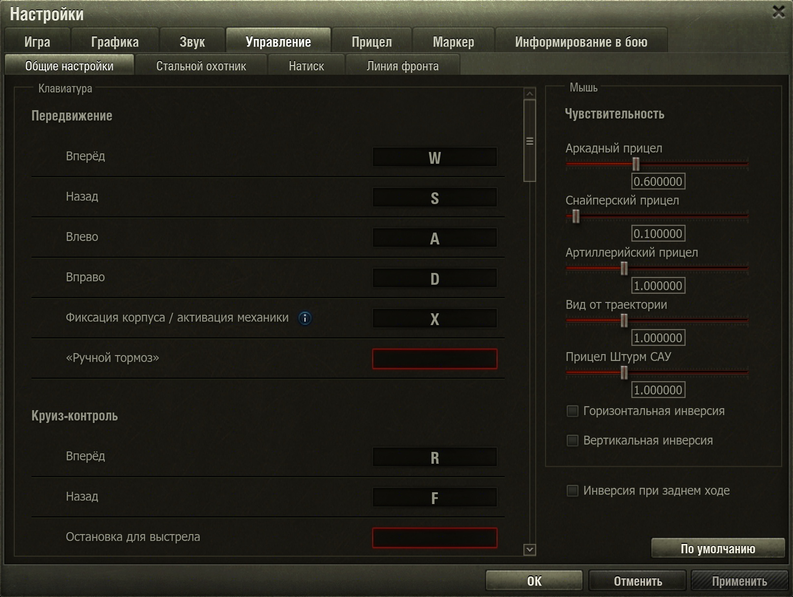
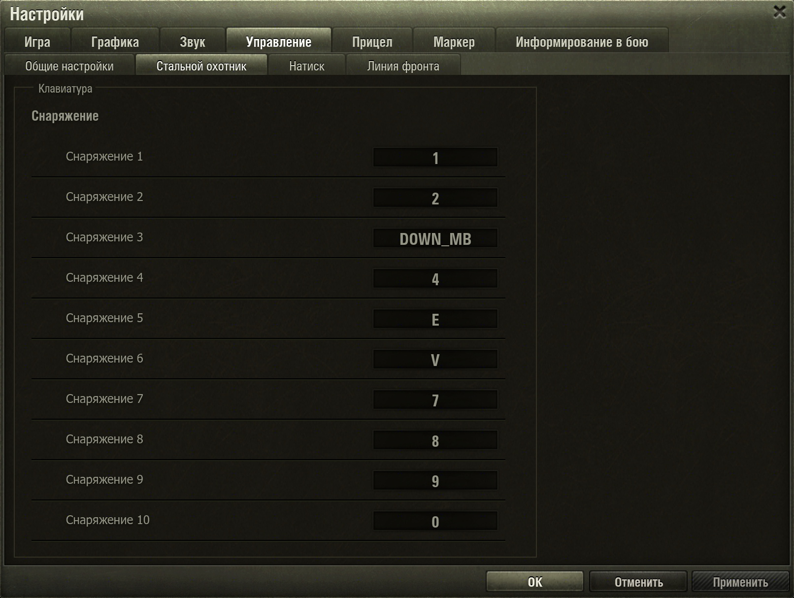

# Улучшенные настройки управления

`nidin.improved_control_settings` — мод для «Мира танков»: отдельные клавиши снаряжения для **Стального охотника, Натиска и Линии фронта** и точный ввод чувствительности мыши в стандартных настройках.

[Скачать мод](https://github.com/xNIDINx/improved-control-settings/releases/latest) · [Изменения в версии 1.0.12](https://github.com/xNIDINx/improved-control-settings/releases/tag/v1.0.12)

## Установка

Закройте игру и скопируйте файл `.mtmod` из релиза без распаковки в `<папка игры>/mods/<версия клиента>/`. Оставьте только одну версию мода.

Если установлены прежние отдельные моды `nidin.mouse_sensitivity` или `nidin.mode_control_profiles`, уберите их из этой папки: их возможности уже включены в этот мод.

Дополнительные моды и библиотеки для работы не нужны.

## Управление

Откройте **Настройки → Управление**.

- **Профили режимов.** Выберите вкладку режима и назначьте клавиши снаряжения. В бою соответствующий профиль включается автоматически. Изменения одного профиля не затрагивают остальные; случайные бои и другие режимы используют общие клавиши.
- **Чувствительность мыши.** На вкладке «Общие настройки» введите точное значение в поле под нужным ползунком. Tab переключает поля сверху вниз, Shift+Tab — обратно; после последнего поля Tab переводит фокус на крестик окна. Чувствительность остаётся общей для всех режимов.
- **Сохранение.** Нажмите «Применить» или «ОК», чтобы сохранить изменения. «Отмена» отменяет неприменённые изменения.

## Автор и условия распространения

Автор — **NIDIN**. Разрешено распространять неизменённые копии мода с сохранением авторства и полного текста условий. Изменение кода и распространение изменённых версий требуют разрешения автора. Обычная настройка через предусмотренные параметры разрешена.

Полные условия — в [LICENSE](LICENSE). Они относятся к собственному коду и материалам автора; права на ресурсы игры и сторонние компоненты сохраняются за их правообладателями.
